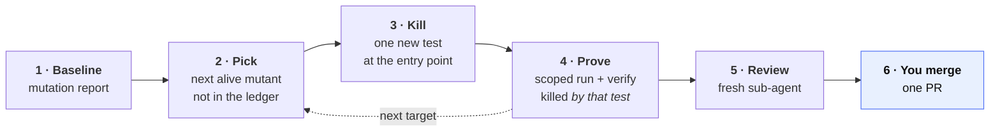
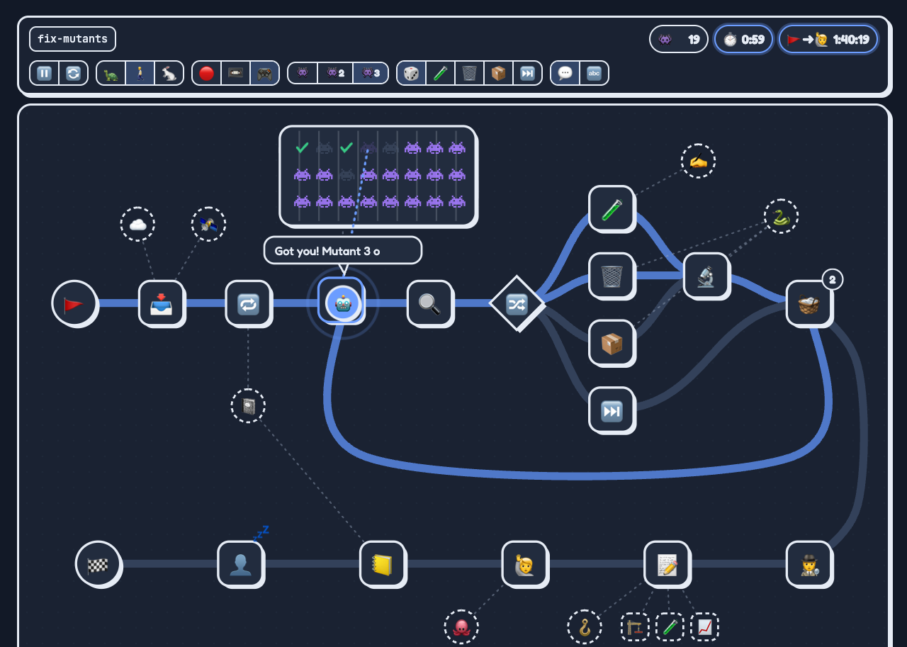

<div align="center">

# 🧬 fix-mutants

### Kill surviving mutants. One test each. Checked by a script, reviewed by a human.

**An agent skill that turns a mutation-testing report into small, reviewed pull requests.**<br/>
Plain `SKILL.md` + stdlib-only Python. Any stack that emits a mutation-testing-elements report.<br/>
Your agent picks the next mutant, writes **one** test at the right layer, proves it kills that mutant, and opens a PR — **it never merges**.

[](https://github.com/Amirault/fix-mutants/actions/workflows/ci.yml)
[](LICENSE)


</div>

<br/>



<sub>Blue = you decide. Everything else is done by the agent; every mechanical claim is checked by a script.</sub>

<div align="center">



<sub>The bundled board, in demo mode. Point it at a real Claude Code run to follow it live — see <a href="#-watch-a-run">Watch a run</a>.</sub>

</div>

## Why fix-mutants

Mutation testing tells you which lines your tests don't really check. Fixing those findings is slow, repetitive and easy
to get subtly wrong: a test at the wrong layer, an existing assertion quietly loosened, a `Killed` status that came from an
unrelated test, dead code "covered" instead of deleted. Agents make the same mistakes, only faster.

`fix-mutants` gives your agent (Claude Code, or any agent that reads `SKILL.md`) a strict procedure for that work, small
scripts that check each claim mechanically, and a ledger so the next run starts where the last one stopped.

Extracted from a skill used in batches of 10+ mutants on a production .NET codebase, then made stack-agnostic: everything
project-specific lives in a profile next to your code.

## ⚡ In 60 seconds

Needs `git`, **Python ≥ 3.9** (standard library only), your mutation tool, and an agent that supports skills.

```bash
git clone https://github.com/Amirault/fix-mutants.git
fix-mutants/install.sh ~/code/my-project     # copies the skill, detects your stack, writes .fix-mutants/
```

1. **Name your layers** in `my-project/.fix-mutants/PROFILE.md` — the one thing the installer cannot guess.
2. **Produce a baseline** once — `.fix-mutants/report-fetch.md` has the exact commands for your stack.
3. **Ask your agent**:

```text
/fix-mutants                 # the first alive mutant not dealt with yet
/fix-mutants 5               # the next five, planned and reviewed as one run
/fix-mutants Discount.cs     # the alive mutants of one file
```

The agent picks the target, writes the test, runs the scoped mutation tool, verifies, gets an independent review, commits
once on a branch and opens the PR. You review and merge.

<details>
<summary><b>Install options</b></summary>

<br/>

```bash
./install.sh <project> --stack generic                                       # any other tool: profile with TODOs
./install.sh <monorepo>/services/shop --production src/Shop --tests tests/Shop.Tests   # pick a project explicitly
./install.sh <project> --target both                                         # .claude/skills and .agents/skills
```

Re-run `install.sh` to update the skill: it replaces the skill folder and leaves your `.fix-mutants/` profile untouched.

</details>

## 🛡️ The gates

| | Gate | What it enforces |
| :-: | --- | --- |
| 🧪 | **Tests first** | One new test per mutant, through the public entry point that really owns the code. Production code only as a last resort. |
| 🔒 | **Existing tests are frozen** | No edited assertion, fixture or helper. The `gate` command fails on any staged change outside the test roots. |
| 🎯 | **Killed by *that* test** | `verify` matches file + location + mutator + replacement and requires the new test in `killedBy`. |
| 🔎 | **Uncapped evidence** | Caller searches are never truncated; dead code needs grep + `git log` proof, and `check` proves it is really gone. |
| ⏭️ | **No silent behaviour change** | A mutant that reveals a real defect is skipped, with a plain-language *Decisions needed* entry in the PR. |
| 👀 | **Independent review** | A fresh sub-agent with no context reviews the whole run before anything is committed. |
| 📦 | **One PR, one commit** | Hooks run once; the PR has one block per mutant, a totals table and a progress chart. Never self-merged. |
| 📒 | **Nothing examined is lost** | Every mutant looked at gets a ledger row: fixed, resolved, skipped with a reason, or queued for the next run. |

## 🧭 How a run works

| Step | What happens | Checked by |
| :-: | --- | --- |
| 0 | Scope the request: which mutants, which profile; start the request → PR clock | — |
| 1 | Fetch the report, verify its checksum, sync the ledger (regressions, queued targets) | `baseline`, `ledger.py validate` |
| 2–3 | Read the mutant, trace the code up to the nearest entry point, write **one** test there | `verify` — killed **by the new test** |
| 4 | Last resort: delete dead code, move misplaced code, with evidence | `check` — file really gone, span really absent |
| 5 | Scoped mutation re-run; every mutant outside the target file must be `Ignored` | `verify` |
| 6 | One independent sub-agent review of the whole run, from a checklist | the reviewer |
| 7 | One commit, ledger and tracker updated, PR from a template | `gate` — test-only diff |

Steps 2–5 loop once per target, each staged as soon as it is verified. A multi-mutant run is planned first, in strict
report order, and the plan itself is reviewed before any edit.

<details>
<summary><b>What the PR looks like</b></summary>

<br/>

In this order, essentials first:

- **Why** — one paragraph, no report indexes.
- **Totals** — a subtraction table (baseline remaining − new tests − deleted − moved = remaining after this PR), the fix
  duration and the request → PR duration, plus a progress chart of alive mutants per baseline.
- **Review focus** — at most three lines, riskiest first: deleted or moved code, edited tests, disagreements with the reviewer.
- **Decisions needed** — only when something is skipped: situation, a concrete example, options, a recommendation.
- **How each mutant was killed** — one collapsed block per mutant, grouped by kill type: 🧪 new test, ⚠️✏️ test edited,
  ⚠️🗑️ dead code deleted, ⚠️📦 code moved, ⏭️ skipped. Each holds the code before, the code with the mutation, and how it was killed.

Template: [`references/pr-template.md`](skills/fix-mutants/references/pr-template.md).

</details>

<details>
<summary><b>The decision rules</b></summary>

<br/>

The rules the skill never bends are in [`SKILL.md`](skills/fix-mutants/SKILL.md) and
[`references/decision-rules.md`](skills/fix-mutants/references/decision-rules.md), learned from real multi-mutant runs:

- **Skips** have one of four categories: `real-defect`, `unclaimable`, `equivalent`, `unobservable`.
- **Dead but tested** code is deleted with the tests that existed only for it; **test-only helpers** move next to their usage;
  a **blocked move** is killed in place and flagged for later.
- **Non-unique spans** are never claimed by broadening the removed excerpt.
- **Twin files** are checked together, so a clone is never claimed out of report order.
- **Two clocks**, both measured by script: the fix duration per target (selection → green `verify`) and request → PR.

</details>

## 🧪 Try it on a sandbox first

Two tiny projects with deliberately weak tests live in [`examples/`](examples), each with its generated profile and one
mutant already fixed.

| Sandbox | Stack | Alive mutants |
| --- | --- | :-: |
| [`examples/dotnet`](examples/dotnet) | .NET 9, NUnit, Stryker.NET 4.8 | 5 |
| [`examples/js`](examples/js) | Node, Jest, StrykerJS 8 | 3 |

```bash
examples/check-sandbox.sh dotnet     # mutation run → baseline → list; fails if the count drifts
examples/check-sandbox.sh js
```

<details>
<summary><b>A real round trip (.NET sandbox)</b></summary>

<br/>

```text
$ mutant_checks.py baseline --repo . --report '…/StrykerOutput/*/reports/mutation-report.json' --out baseline.json
{"remaining": 6, "report_sha256": "1a5511ca…"}

$ mutant_checks.py list --repo . --baseline baseline.json --limit 1
{"index": 0, "where": "examples/dotnet/src/Shop/LoyaltyDiscount.cs:7", "mutator": "Equality mutation",
 "original": "yearsAsCustomer >= 5", "mutated": "yearsAsCustomer > 5"}
```

Nothing tests a customer with *exactly* five years, so `>=` → `>` survives. One new test:

```csharp
[Test]
public void Given_customer_with_exactly_five_years_When_applying_Should_give_ten_percent()
{
    Assert.That(LoyaltyDiscount.Apply(100m, 5), Is.EqualTo(90m));
}
```

Scoped mutation run, then the mechanical checks:

```text
$ dotnet stryker --project Shop.csproj --test-project Shop.Tests.csproj --mutate "**/LoyaltyDiscount.cs" --reporter json
$ mutant_checks.py verify … --mutant-id 2 --outcome test --new-test Given_customer_with_exactly_five_years_…
                                                                       # exit 0: Killed, by that test
$ mutant_checks.py gate --repo .
{"test_only": true, "staged": ["examples/dotnet/tests/Shop.Tests/LoyaltyDiscountTests.cs"]}
```

The ledger row is in [`examples/dotnet/.fix-mutants/ledger.jsonl`](examples/dotnet/.fix-mutants/ledger.jsonl), the sync
log in [`MUTATION-TRACKING.md`](examples/dotnet/.fix-mutants/MUTATION-TRACKING.md). The JS sandbox has the same
walkthrough (`calculateShipping(0, 1)` kills `orderTotal < 0` → `<= 0`).

</details>

## 📺 Watch a run

The skill ships an animated board of its own workflow, for humans; the agent never needs it.

```bash
python3 .claude/skills/fix-mutants/scripts/board_feed.py serve --open
```

| Mode | Shows |
| --- | --- |
| 🔴 **Live** | the newest `/fix-mutants` run in your local Claude Code transcripts, step by step as it happens |
| 📼 **Replay** | the same run, from the start, sped up |
| 🎮 **Demo** | a simulated run, no transcript needed (also: open `assets/board.html` directly) |

The feed only watches what the agent runs (it reads `~/.claude/projects/**/*.jsonl`, read-only, nothing leaves your
machine) and tells test files from production files with your profile.

## 🧩 Adapting it to your project

`install.sh` generates everything; this is what it writes and what to tune.

```text
your-project/
├── .claude/skills/fix-mutants/      the skill (update it by re-running install.sh)
└── .fix-mutants/                    YOURS, versioned with your code
    ├── profile.json                 production_root, test_roots, report schema, declaration pattern, gate_allow
    ├── PROFILE.md                   environment, scoped mutation command, layers, caller search, conventions
    ├── report-fetch.md              how the baseline report is obtained and verified
    ├── ledger.jsonl                 one row per examined mutant, written by ledger.py
    └── MUTATION-TRACKING.md         latest baseline, score trend, execution history, sync log
```

Worth editing by hand: the **layers** section of `PROFILE.md`; `report-fetch.md` if CI already publishes a report (replace
the local run with your fetch + checksum); `gate_allow` if tests legitimately update coverage baselines or snapshots.
Format reference: [`references/profile.md`](skills/fix-mutants/references/profile.md).

<details>
<summary><b>Supported stacks</b></summary>

<br/>

| Tool | Status | Notes |
| --- | --- | --- |
| Stryker.NET (C#) | ✅ validated end to end (4.8.1, .NET 9) | run from the test project folder: a solution file above it switches Stryker to solution mode |
| StrykerJS (JS/TS) | ✅ validated end to end (8.x, Jest) | add `ignorePatterns` for `.claude`, `.agents`, `.fix-mutants`, `reports` (the generated profile says so) |
| Stryker4s, Pitest (elements reporter) | ⚠️ should work, not tested | `--stack generic`, fill the TODOs, check one round trip |
| mutmut, cosmic-ray, others | ❌ needs a converter | the scripts read the [mutation-testing-elements](https://github.com/stryker-mutator/mutation-testing-elements) JSON schema |

</details>

<details>
<summary><b>The scripts</b></summary>

<br/>

All in [`skills/fix-mutants/scripts/`](skills/fix-mutants/scripts), plain Python ≥ 3.9, standard library only, covered by
[107 unit tests](skills/fix-mutants/scripts/tests).

| Command | Purpose |
| --- | --- |
| `mutant_checks.py baseline` | raw report → alive mutants only, repo-relative paths, sha256 |
| `mutant_checks.py list` | alive mutants in report order, with original and mutated code |
| `mutant_checks.py check` | after staging a removal/move: file physically absent and deletion staged; code span really gone |
| `mutant_checks.py verify` | after the scoped run: target `Killed` by the named test, nothing outside scope active, no foreign test project |
| `mutant_checks.py gate` | fails unless the staged diff touches only test roots, `.fix-mutants/` and `gate_allow` |
| `mutant_checks.py duration` | human-readable elapsed time between two UTC timestamps (`38m 29s`) |
| `ledger.py find / add / update / fill-pr / validate` | read and write the ledger, schema-checked on every write |
| `init_profile.py` | detect the stack and write `.fix-mutants/` |
| `board_feed.py serve / events` | the board and its live feed |

</details>

<details>
<summary><b>Limitations</b></summary>

<br/>

- It reasons about code with an LLM: semantic checks (is this really dead? is this the right layer?) are guarded by the
  independent review and your PR review, not proven. The scripts prove the *mechanical* claims only.
- `check` verifies whole-file moves and unique removed spans; a member move out of a file that stays is killed in place instead.
- Fully exercised with Claude Code; the procedure is plain markdown and works with any agent that follows `SKILL.md`.
  The live board reads Claude Code transcripts only.

</details>

<details>
<summary><b>Repository layout, development & license</b></summary>

<br/>

```text
skills/fix-mutants/     the portable skill: SKILL.md, references/, scripts/, assets/board.html
install.sh              copy the skill into a project and generate its profile
examples/dotnet|js      sandboxes with a generated profile and one mutant already fixed
.github/workflows/      unit tests, both sandboxes, fresh-install run
```

```bash
python3 -m unittest discover -s skills/fix-mutants/scripts/tests
```

[MIT](LICENSE) — made by [@Amirault](https://github.com/Amirault).

</details>
